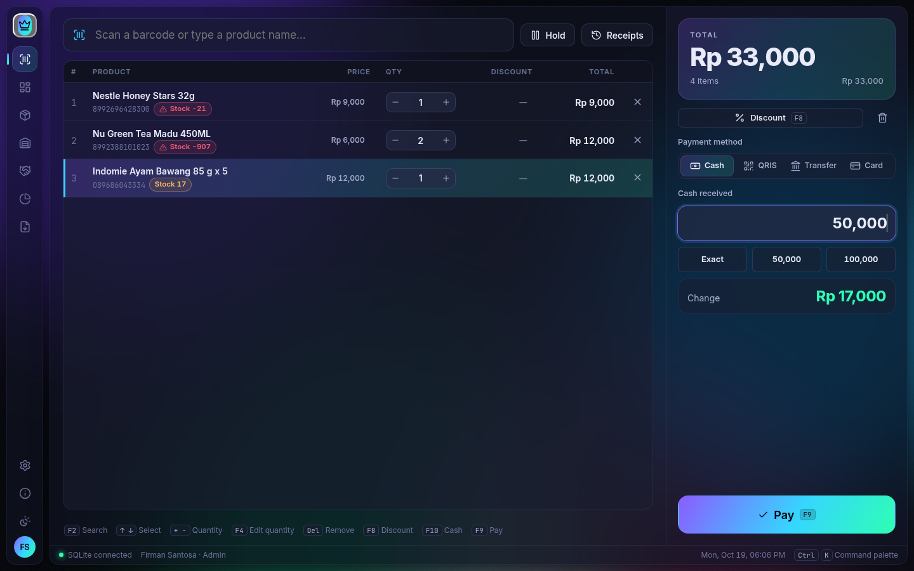
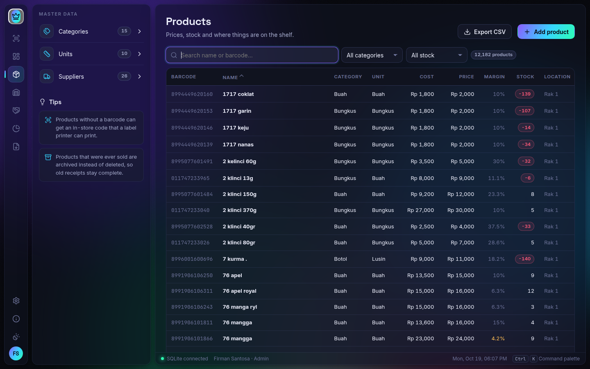

# Raja Kasir

### Sistem kasir & manajemen ritel profesional

Cepat di meja kasir · Lengkap untuk pengelolaan toko · Tetap bekerja tanpa internet · Data sepenuhnya milik Anda

**[🛒 Pesan Lisensi via WhatsApp](https://wa.me/628121858819?text=Halo%20Raja%20Coding%2C%20saya%20ingin%20memesan%20lisensi%20Raja%20Kasir.)** &nbsp;·&nbsp; **[⬇️ Unduh Installer](https://github.com/firexsantos/rajakasir-releases/releases/latest)** &nbsp;·&nbsp; **[✨ Situs Raja Kasir](https://firexsantos.github.io/rajakasir/)** &nbsp;·&nbsp; **[🌐 rajacoding.com](https://rajacoding.com)**

 

---

## ✨ Fitur Utama

| | |
|---|---|
| 🧾 **Kasir cepat** | Scan barcode (termasuk barcode dus), cari nama barang, diskon, tunai / QRIS / transfer / kartu, kembalian otomatis, tahan transaksi, sesi kasir dengan modal awal & hitung laci. Semua bisa lewat keyboard. |
| 👥 **Pelanggan & poin** | Member dengan poin belanja yang bisa ditukar di kasir, harga member, riwayat belanja per pelanggan. |
| 🏷️ **Harga & promo** | Harga grosir bertingkat, jual per dus/pak, promo diskon / harga spesial / beli X gratis Y, perubahan harga massal dengan riwayat harga, PPN. |
| 📦 **Manajemen barang** | Puluhan ribu barang tetap lancar. Kategori, satuan, supplier, margin, stok minimum, lokasi gudang & rak, label barcode. |
| 🏬 **Stok & kedaluwarsa** | Stok per gudang & transfer, stok opname, kedaluwarsa per batch dengan peringatan, pemusnahan barang dengan berita acara, pecah barang dus → ecer. |
| 🚚 **Pembelian & hutang** | Purchase order, barang masuk tunai / tempo, hutang supplier dengan umur hutang, retur ke supplier. |
| 🤝 **Grosir & piutang** | Faktur untuk reseller, pembayaran cicilan, umur piutang per mitra, cetak faktur A4. |
| 📊 **Laporan & dasbor** | Omzet, laba, barang terlaris, pelanggan, pajak, kerugian, jam ramai, nilai persediaan. Cetak A4/Letter/Legal/F4 atau ekspor CSV. |
| 🖨️ **Struk sesuai selera** | Pembuat struk dengan 6 template, printer thermal 58 / 76 / 80 mm, pratinjau sebelum cetak. |
| 🔄 **Pindah dari aplikasi lama** | Impor data dari backup MySQL (.sql) aplikasi kasir lama atau daftar barang Excel (.xlsx / .csv), lengkap dengan pratinjau sebelum disimpan. |
| 🗄️ **Pilihan database** | SQLite (otomatis, tanpa server), MySQL / MariaDB, atau PostgreSQL. Backup otomatis harian & pemulihan. |
| 🔐 **Multi pengguna & aman** | Login dengan PIN pribadi, peran admin dan kasir, log aktivitas. |
| 🎨 **Identitas toko Anda** | Nama, logo, alamat, dan warna merek toko sendiri. Tampilan Bahasa Indonesia & Inggris, tema gelap & terang. |
| ⬆️ **Pembaruan otomatis** | Versi baru diunduh di latar belakang dan dipasang saat Anda memilih — data tidak tersentuh. |

---

## 🛒 Cara Pemesanan

1. **Hubungi kami** melalui WhatsApp **[+62 812-1858-819](https://wa.me/628121858819?text=Halo%20Raja%20Coding%2C%20saya%20ingin%20memesan%20lisensi%20Raja%20Kasir.)** untuk informasi harga dan paket. Sebutkan jumlah komputer kasir yang akan dipakai.
2. **Lakukan pembayaran** sesuai penawaran yang Anda terima.
3. **Unduh dan pasang** Raja Kasir dari halaman [Releases](https://github.com/firexsantos/rajakasir-releases/releases/latest).
4. **Kirim ID Perangkat** yang tampil di layar aktivasi saat aplikasi pertama kali dibuka.
5. **Terima key lisensi**, tempel di layar aktivasi, lalu tekan **Aktifkan** — Raja Kasir siap digunakan.

> Satu key lisensi berlaku untuk **satu perangkat**. Untuk beberapa komputer kasir, pesan sesuai jumlah perangkat.

---

## ⬇️ Unduhan

Unduh dari **[Releases → versi terbaru](https://github.com/firexsantos/rajakasir-releases/releases/latest)**:

| Sistem operasi | Berkas | Cara pasang |
|---|---|---|
| Windows 10 / 11 (64-bit) | `rajakasir-setup-<versi>.exe` | Jalankan, ikuti petunjuk pemasangan |
| Ubuntu / Debian (64-bit) | `rajakasir-<versi>-amd64.deb` | Klik dua kali, atau `sudo apt install ./rajakasir-<versi>-amd64.deb` |
| Linux lainnya (64-bit) | `rajakasir-<versi>-x86_64.AppImage` | Izinkan dijalankan (*executable*), lalu buka |

Keaslian berkas dapat diperiksa dengan `SHA256SUMS.txt` pada setiap rilis.

**Kebutuhan minimum:** prosesor 64-bit, RAM 4 GB, ruang disk kosong 500 MB, layar 1366×768.
Printer struk thermal, scanner barcode, dan laci kas bersifat opsional.

---

## 🕑 Riwayat Versi

<!-- history:start -->
### 0.9.0 · 20 Oktober 2026 — terbaru

#### Baru
- **Peran pengguna: Owner, Super Admin, dan Kasir** — satu orang bisa memiliki lebih dari satu peran.
  - **Owner**: semua akses, ditambah pengguna & peran, log aktivitas, backup & pulihkan, dan pengaturan database.
  - **Super Admin**: menambah, mengubah, dan menghapus data toko — barang, stok, pembelian, harga, pelanggan, promo, grosir, laporan, dan pengaturan toko.
  - **Kasir**: meja kasir, sesi kasir sendiri, dan penjualan sendiri.
  - Menu, bagian pengaturan, dan data yang tampil menyesuaikan peran yang sedang aktif.
- **Ganti peran** lewat tombol peran di kiri bawah (atau **Ctrl+Shift+U**).
  - Muncul pilihan semua peran yang Anda miliki, lalu tampilan berganti dengan animasi sesuai warna peran.
  - Kasir langsung dibawa ke meja kasir; Owner dan Super Admin ke dasbor.
  - Saat masuk berikutnya, Raja Kasir memakai peran terakhir Anda.
- **Tombol Tutup di setiap halaman**, di samping tombol peran (juga di layar masuk).
  - Sebelum menutup muncul konfirmasi, lalu database dicadangkan.
  - Jika sesi kasir masih terbuka, ada pemberitahuan. Sesi tetap terbuka, dan saat Raja Kasir dibuka lagi Anda melanjutkan sesi tersebut.
- Pengaturan → **Pengguna & peran**: penjelasan tiap peran, dan pilihan beberapa peran untuk setiap orang.

#### Perubahan
- Pengguna admin yang sudah ada otomatis menjadi **Owner + Kasir**, jadi tidak ada akses yang hilang. Kasir tetap Kasir.
- Menu **Tentang** dan **Ganti tema** kini ada di menu pengguna (klik inisial nama Anda).

[Halaman rilis 0.9.0](https://github.com/firexsantos/rajakasir-releases/releases/tag/v0.9.0)

### 0.8.0 · 20 Oktober 2026

#### Baru
- **Kunci demo harian** — untuk mencoba Raja Kasir sebelum membeli lisensi.
  - Satu kunci untuk komputer mana saja, berlaku hanya pada tanggalnya sampai pukul 23:59 WIB. Keesokan harinya kunci berganti.
  - Kunci demo hari ini selalu tersedia di [halaman Raja Kasir](https://firexsantos.github.io/rajakasir/#demo); layar aktivasi juga menautkannya.
  - Selama demo, bilah status menampilkan **Mode demo**, dan struk serta dokumen cetak bertanda **DEMO — bukan bukti transaksi sah**.
  - Setelah masa demo habis, aplikasi kembali ke layar aktivasi. Data yang sudah dimasukkan tetap tersimpan dan bisa dilanjutkan setelah membeli lisensi.
  - Kunci demo tidak bisa dipakai ulang dengan memundurkan tanggal komputer, dan tidak pernah menggantikan lisensi penuh yang masih aktif.

[Halaman rilis 0.8.0](https://github.com/firexsantos/rajakasir-releases/releases/tag/v0.8.0)

<b>0.7.1</b> · 20 Oktober 2026

#### Pembaruan
- **Menutup aplikasi lebih aman**
  - Saat Raja Kasir ditutup (tombol ×, Alt+F4, menu Keluar, atau **Tutup Raja Kasir** di menu pengguna), muncul konfirmasi terlebih dahulu.
  - Konfirmasi itu memberi peringatan kalau sesi kasir masih terbuka.
  - Database lalu dicadangkan dengan layar progres: menyimpan transaksi, mencadangkan database, dan menyalin ke folder backup jika diatur. Setelah itu aplikasi tertutup.
  - Kalau backup gagal, Anda tetap bisa memilih menutup atau tetap membuka aplikasi.
  - Backup saat menutup bisa dimatikan di Pengaturan → Backup & pulihkan.
- **Layar penuh otomatis** — Raja Kasir langsung terbuka layar penuh. Tekan **F11** untuk beralih. Mode pembukaan (layar penuh, maksimal, atau jendela) bisa dipilih di Pengaturan → Umum.

[Halaman rilis 0.7.1](https://github.com/firexsantos/rajakasir-releases/releases/tag/v0.7.1)

<b>0.7.0</b> · 20 Oktober 2026

#### Baru
- **Pembuat struk** — di Pengaturan → Struk & printer → Desain.
  - **6 template siap pakai:** Klasik, Minimalis, Modern, Hemat kertas, Detail & pajak, Member & promo.
  - **Blok bisa diatur bebas:** ditambah, dihapus, diurutkan dengan diseret, disembunyikan, atau digandakan.
  - **Setiap blok punya pengaturan sendiri:** rata kiri/tengah/kanan, ukuran, huruf tebal, gaya garis pemisah, susunan barang, total besar, kotak poin member, dan teks bebas (misalnya akun Instagram toko).
  - **Barcode nomor struk** bisa ditambahkan untuk mempercepat retur.
  - **Pratinjau langsung** memakai contoh transaksi lengkap: per dus, promo, pelanggan, PPN, dan poin.
- **Pratinjau sebelum mencetak**
  - Struk yang dicetak manual (setelah bayar, dari riwayat struk, dan dari Penjualan) ditampilkan dulu sebelum dicetak. Cetak otomatis setelah bayar tetap langsung mencetak.
  - Dialog cetak label menampilkan pratinjau langsung lembar stiker A4 atau label rol.

Tampilan struk Anda tidak berubah sampai Anda memilih template lain.

[Halaman rilis 0.7.0](https://github.com/firexsantos/rajakasir-releases/releases/tag/v0.7.0)

<b>0.6.2</b> · 20 Oktober 2026

#### Pembaruan
- Hitung laci saat membuka dan menutup sesi kasir kini mencakup pecahan **Rp 75.000**.

[Halaman rilis 0.6.2](https://github.com/firexsantos/rajakasir-releases/releases/tag/v0.6.2)

<b>0.6.1</b> · 20 Oktober 2026

#### Pembaruan
- **Peringatan barang kedaluwarsa**
  - Badge merah (sudah kedaluwarsa) atau kuning (kedaluwarsa minggu ini) di menu Dashboard dan Stok, diperbarui otomatis.
  - Panel peringatan di dashboard yang menampilkan nilai barang berisiko, dengan tombol **Musnahkan yang kedaluwarsa** yang langsung mengisi berita acara pemusnahan.
  - Di kasir, barang yang punya stok kedaluwarsa diberi tanda merah dan memunculkan peringatan saat di-scan.
- **Tutup sesi kasir lebih mudah**
  - Tombol **Tutup sesi** di bagian atas layar kasir dan di menu pengguna.
  - Saat keluar dengan sesi masih terbuka, Anda ditanya apakah sesi mau ditutup atau dibiarkan terbuka.
  - Admin bisa menutup sesi kasir lain dari Penjualan → Sesi kasir.

#### Perbaikan
- Tombol "Pilih pelanggan" di kasir kini menampilkan teksnya.

[Halaman rilis 0.6.1](https://github.com/firexsantos/rajakasir-releases/releases/tag/v0.6.1)

<b>0.6.0</b> · 20 Oktober 2026

Stok per lokasi dan transfer antar gudang.

#### Baru
- **Stok per lokasi** — lihat berapa stok di rak toko dan berapa di gudang. Toko sebagai lokasi jual memegang semua stok yang tidak disimpan di tempat lain, jadi kasir, retur, dan opname tetap bekerja seperti biasa.
- **Barang masuk ke gudang** — pilih lokasi tujuan saat menerima barang. Lokasi bawaannya diatur di Stok → Per lokasi.
- **Transfer stok** — pindahkan barang antar lokasi dengan surat transfer bernomor yang bisa dicetak.
- **Isi ulang rak toko** — daftar barang yang menipis di toko tetapi masih ada di gudang, dan langsung dibuat transfernya.
- **Hitung per gudang** — selisih hitung mengoreksi stok lokasi itu dan total stok.

#### Data Anda aman
Database diperbarui otomatis setelah cadangan dibuat. Semua stok yang sudah ada tetap tercatat di toko, dan import `.sql` dari sistem lama tetap berfungsi.

[Halaman rilis 0.6.0](https://github.com/firexsantos/rajakasir-releases/releases/tag/v0.6.0)

<b>0.5.0</b> · 20 Oktober 2026

Pelanggan & poin, jual per dus, harga grosir bertingkat, promo, PPN, label barcode, backup otomatis, dan log aktivitas.

#### Baru
- **Pelanggan & member** — pilih atau tambah pelanggan di kasir dengan **F3**. Riwayat belanja, barang favorit, dan belanja per bulan tersedia per pelanggan.
- **Poin loyalti** — pelanggan mengumpulkan poin dari setiap belanja dan bisa memakainya sebagai potongan di kasir. Poin otomatis dikembalikan jika transaksi dibatalkan.
- **Jual per dus / pak** — setiap satuan punya barcode dan harga sendiri. Scan barcode dus langsung menjual satu dus, dan stok tetap dihitung per ecer.
- **Harga grosir bertingkat & harga member** — misalnya mulai 6 pcs Rp 2.800; diterapkan otomatis di kasir.
- **Promo** — diskon persen atau nominal, harga spesial, atau beli X gratis Y. Bisa per barang, per kategori, atau semua barang, dengan periode, hari tertentu, dan khusus member. Nama promo tercetak di struk.
- **PPN** — harga termasuk atau belum termasuk pajak, barang bisa dibebaskan dari pajak, dan PPN tampil di struk (dengan NPWP) serta di Laporan → Pajak.
- **Label barcode** — untuk kertas stiker A4 (3×8, 4×10, 5×13) atau printer label (50×30, 38×25, 33×15).
- **Backup & pulihkan** — backup otomatis setiap hari, salinan ke flashdisk atau folder cloud, unduh/unggah backup, dan pulihkan data (cadangan pengaman dibuat lebih dulu). Backup juga bisa dipakai untuk pindah dari SQLite ke MySQL/PostgreSQL.
- **Log aktivitas** — siapa yang masuk, salah PIN, mengubah harga, membatalkan transaksi, menyesuaikan stok, dan lainnya.
- **Laporan Pelanggan & Pajak**; laporan penjualan kini menampilkan promo, poin, dan PPN.

#### Data Anda aman
Database diperbarui otomatis ke struktur baru setelah cadangan dibuat. Tidak ada data yang dihapus, dan import `.sql` dari sistem lama tetap berfungsi seperti biasa.

[Halaman rilis 0.5.0](https://github.com/firexsantos/rajakasir-releases/releases/tag/v0.5.0)

<b>0.4.0</b> · 20 Oktober 2026

Pembaruan besar untuk pengelolaan toko: pembelian & hutang supplier, retur, tanggal kedaluwarsa per batch, pemusnahan barang, pecah barang, lokasi rak, perubahan & riwayat harga, serta sesi kasir.

#### Baru
- **Pembelian** — barang masuk lunas, tempo (kredit), atau dibayar sebagian dengan jatuh tempo otomatis dari tempo supplier. Harga jual bisa langsung diperbarui saat barang masuk.
- **Purchase order (PO)** — draf → terkirim → diterima sebagian/penuh. Tombol **Saran** mengisi barang yang stoknya menipis; PO bisa dicetak A4 atau disalin sebagai teks WhatsApp, lalu barang diterima langsung dari PO.
- **Supplier & hutang** — data kontak, rekening, dan tempo; riwayat pembelian per supplier; daftar hutang dengan umur hutang; bayar per faktur atau satu nominal yang melunasi faktur terlama lebih dulu.
- **Retur** — retur pelanggan dari struk (barang baik kembali ke stok, barang rusak dicatat sebagai kerugian) dan retur ke supplier (uang kembali, potong hutang, atau diganti barang).
- **Kedaluwarsa per batch** — setiap barang masuk menyimpan tanggal kedaluwarsanya sendiri; penjualan otomatis mengambil batch yang paling dulu kedaluwarsa (FEFO).
- **Pemusnahan barang** — untuk barang kedaluwarsa, rusak, hilang, atau dipakai toko, lengkap dengan saksi dan **berita acara** bernomor yang bisa dicetak.
- **Pecah barang** — dus → ecer; stok, tanggal kedaluwarsa, dan modal ikut berpindah.
- **Lokasi** — gudang dan rak, penempatan banyak barang sekaligus, stok opname per rak.
- **Perubahan & riwayat harga** — ubah harga banyak barang sekaligus (margin, markup, persen, nominal) dengan pratinjau; setiap perubahan modal dan harga tercatat.
- **Sesi kasir** — modal awal saat mulai shift, kas masuk/keluar, hitung laci per pecahan saat tutup, selisih tercatat, laporan shift bisa dicetak.
- **Penjualan** — semua struk dengan filter lengkap, cetak ulang, retur, dan pembatalan; daftar retur dan sesi kasir.
- **Laporan Kerugian** dan omzet bersih setelah retur.

#### Perubahan
- Menu **Barang masuk** pindah ke **Pembelian**.
- Efek visual **Ringan** menjadi bawaan agar aplikasi tetap cepat di PC kasir (bisa diubah di Pengaturan → Umum).

#### Data Anda aman
Saat pertama kali dibuka, database diperbarui otomatis ke struktur baru **setelah cadangan dibuat**. Tidak ada data yang dihapus: nama rak lama menjadi lokasi, pembelian lama dianggap lunas, dan tanggal kedaluwarsa lama menjadi batch.

[Halaman rilis 0.4.0](https://github.com/firexsantos/rajakasir-releases/releases/tag/v0.4.0)

<b>0.3.4</b> · 19 Oktober 2026

#### Pembaruan
- Raja Kasir kini tampil sebagai **sistem kasir dan manajemen ritel profesional** — cepat di meja kasir, lengkap untuk pengelolaan toko, tetap bekerja tanpa internet, dan siap tumbuh bersama bisnis Anda.
- Pengguna Ubuntu/Debian (.deb) versi 0.3.3: pembaruan ini dibuka di App Center — klik **Pasang**, masukkan password komputer, lalu buka kembali Raja Kasir.

[Halaman rilis 0.3.4](https://github.com/firexsantos/rajakasir-releases/releases/tag/v0.3.4)

<b>0.3.3</b> · 19 Oktober 2026

#### Perbaikan
- **Pembaruan untuk pengguna Ubuntu/Debian (.deb):** sebelumnya muncul pesan *"Command pkexec exited with code 127"*. Kini berkas pembaruan dibuka di App Center — cukup klik **Pasang** dan masukkan password komputer. Data dan lisensi tidak terpengaruh.
- Catatan aktivitas pembaruan disimpan untuk memudahkan bantuan teknis.

> **Pengguna .deb versi 0.3.1/0.3.2:** pasang versi ini sekali secara manual (unduh berkas `.deb` di bawah lalu klik dua kali). Pembaruan berikutnya akan berjalan lewat App Center.

**Cara memasang:** unduh berkas untuk sistem operasi Anda di bagian *Assets* di bawah. Pengguna yang sudah memasang Raja Kasir 0.3.0 atau lebih baru akan mendapat pembaruan otomatis.

**Pemesanan lisensi & bantuan:** WhatsApp [+62 812-1858-819](https://wa.me/628121858819) · [rajacoding.com](https://rajacoding.com)

Berkas *Source code (zip/tar.gz)* dibuat otomatis oleh GitHub dan hanya berisi README repositori ini, bukan kode program.

[Halaman rilis 0.3.3](https://github.com/firexsantos/rajakasir-releases/releases/tag/v0.3.3)

<b>0.3.2</b> · 19 Oktober 2026

#### Perjanjian lisensi baru
- Raja Kasir kini memiliki **Perjanjian Lisensi Pengguna Akhir (EULA)** sendiri: satu key lisensi untuk satu perangkat, data toko tetap milik Anda.
- Installer Windows menampilkan perjanjian sebelum pemasangan; aktivasi meminta persetujuan.
- Halaman **Tentang** menampilkan lisensi komersial, perjanjian lisensi, dan daftar komponen sumber terbuka yang digunakan.

[Halaman rilis 0.3.2](https://github.com/firexsantos/rajakasir-releases/releases/tag/v0.3.2)

<b>0.3.1</b> · 19 Oktober 2026

#### Pembaruan tampilan
- Halaman **Tentang** menampilkan pengembang **Firman Santosa, M.Kom — Raja Coding** dengan logo, website, dan kontak WhatsApp.
- Tautan email terbuka langsung di aplikasi email komputer Anda.

[Halaman rilis 0.3.1](https://github.com/firexsantos/rajakasir-releases/releases/tag/v0.3.1)

<b>0.3.0</b> · 19 Oktober 2026

#### Baru
- **Pembaruan otomatis** — versi baru diunduh di latar belakang dan dipasang saat Anda memilih. Data dan transaksi yang sedang berjalan tetap aman.
- **Lisensi per perangkat** — aktivasi dengan key lisensi yang dibuat khusus untuk komputer Anda.
- **Cadangan otomatis** sebelum pembaruan mengubah struktur database.
- Keamanan aplikasi desktop diperketat.

[Halaman rilis 0.3.0](https://github.com/firexsantos/rajakasir-releases/releases/tag/v0.3.0)

<!-- history:end -->

---

## ❓ Tanya Jawab

**Apakah data toko saya aman?**
Ya. Data disimpan di komputer Anda sendiri (atau server database milik Anda). Raja Kasir tidak mengirim data usaha Anda ke kami.

**Apakah butuh internet?**
Tidak untuk berjualan. Internet hanya dipakai untuk mengunduh pembaruan.

**Apakah pembaruan menghapus data?**
Tidak. Pembaruan hanya mengganti program; data tersimpan terpisah dan dicadangkan otomatis bila struktur database perlu ditingkatkan.

**Komputer saya rusak atau install ulang, bagaimana lisensinya?**
Hubungi kami dengan nomor seri lisensi lama dan ID Perangkat baru untuk penggantian key, sesuai ketentuan perjanjian lisensi.

**Apa isi "Source code (zip/tar.gz)" di halaman rilis?**
Itu arsip yang dibuat otomatis oleh GitHub dari isi repositori ini (README, gambar, dan perjanjian lisensi) — bukan kode program Raja Kasir. Untuk memasang aplikasi, unduh berkas installer di atasnya.

---

## 📄 Lisensi

Raja Kasir adalah perangkat lunak berlisensi komersial. Penggunaan tunduk pada
**[Perjanjian Lisensi Pengguna Akhir (EULA)](LICENSE)** — satu key lisensi untuk satu perangkat.
Repositori ini hanya berisi berkas pemasang dan pembaruan; kode program tidak dipublikasikan.

---

**Firman Santosa, M.Kom**
Pengembang — Raja Coding

🌐 [rajacoding.com](https://rajacoding.com) &nbsp;·&nbsp; 💬 [WhatsApp +62 812-1858-819](https://wa.me/628121858819) &nbsp;·&nbsp; ✉️ [firman.snts@gmail.com](mailto:firman.snts@gmail.com)

© 2026 Raja Coding. Seluruh hak dilindungi undang-undang.

